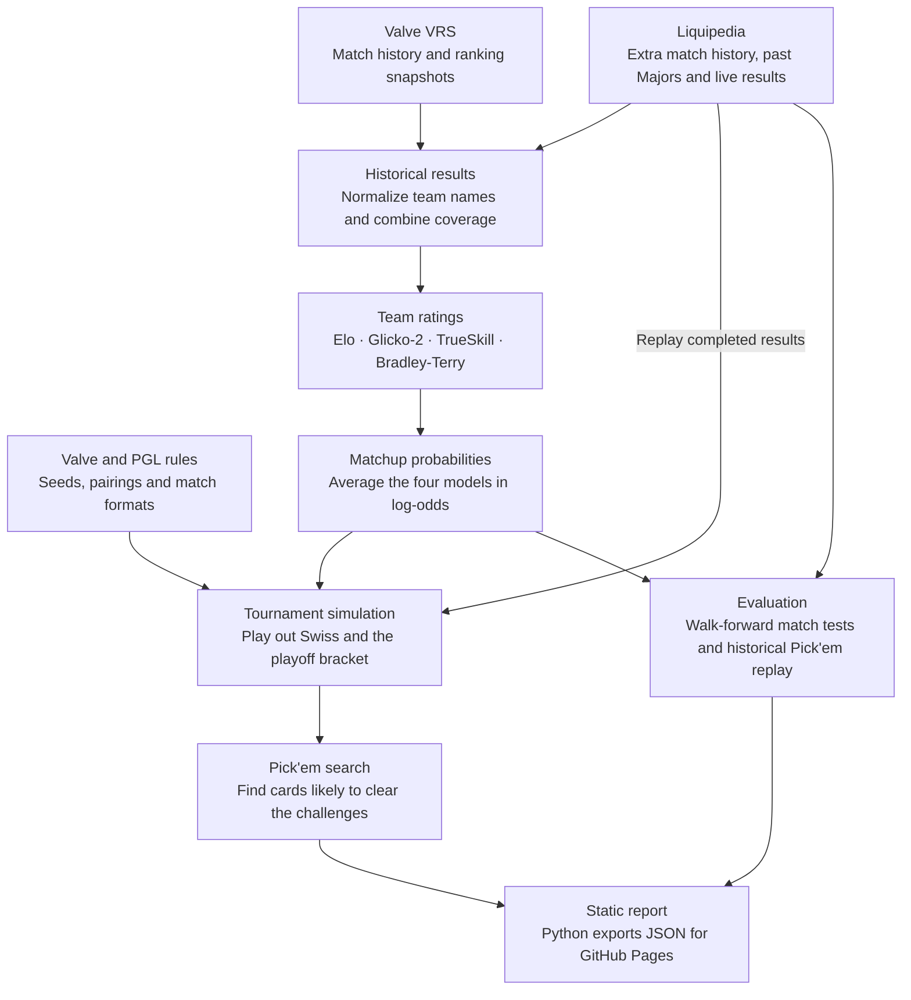

# CS2 Major Predictor

**[Open the interactive PGL Singapore Major report](https://aamarnath1.github.io/cs2-major-predictor/)**

How would you fill out a Pick'em card if you could play the Major thousands of times? This project
starts with public match results, estimates how likely each team is to win a series, and plays out
the Swiss stages and playoffs. The report lets you compare cards, follow a team's path through
Swiss, and see how the forecast changes as real results arrive.

## From match history to a Pick'em card



[Valve's VRS repository](https://github.com/ValveSoftware/counter-strike_regional_standings)
supplies the core history and the ranking baseline. [Liquipedia](https://liquipedia.net/counterstrike/PGL/2026/Singapore)
extends coverage outside the VRS history and supplies tournament results. The simulator uses
[Valve's Major rules](https://github.com/ValveSoftware/counter-strike_rules_and_regs/blob/main/major-supplemental-rulebook.md)
and [PGL's Singapore format](https://www.pglesports.com/cs2/pgl-major-singapore-2026/).
Once a stage reaches its scheduled opener, the report scores only a card saved beforehand.

### What we learned

The four-rater ensemble beat a tuned VRS baseline on 560 historical matches between top-rated
teams. Elo plus Bradley–Terry came close enough that the extra raters have yet to show a clear
benefit. In the corrected historical Pick'em replay, the ensemble averaged 4.45 correct picks
against 4.36 for seed picks across 11 stages. That small gap is uncertain, and some stages predate
the tuning cutoff. A map-pool and veto experiment showed no measurable gain in its test, so it
stays outside the live forecast.

## Run it yourself

### View the included snapshot

Clone the repo and serve the checked-in report with Python. Open <http://127.0.0.1:8600>.

```bash
git clone https://github.com/aamarnath1/cs2-major-predictor.git
cd cs2-major-predictor
python -m http.server 8600 --bind 127.0.0.1 --directory web
```

### Rebuild the forecast

From the repo root, create an environment with Python 3.11 or newer.

```bash
python -m venv .venv
```

Activate it with `.venv\Scripts\Activate.ps1` in PowerShell or `source .venv/bin/activate`
on macOS or Linux. Then run these commands in order. The first Liquipedia backfill is rate-limited
and can take a while. It caches pages locally. A rebuild uses the latest available source data.

```bash
python -m pip install numpy pandas scikit-learn trueskill requests pytest
git clone --depth 1 https://github.com/ValveSoftware/counter-strike_regional_standings data/raw/vrs
python -m cs2p.ingest_vrs
python -m cs2p.ingest_liquipedia
python -m cs2p.backtest
python -m cs2p.backtest_bt
python -m cs2p.run
python -m pytest -q
```

The forecast updates `web/data.json` and writes tables and available pre-cutoff cards to
`outputs/`. Rerun `python -m cs2p.run` after a round to pick up Singapore results. To regenerate
the research sections, run `python -m cs2p.zoo` and `python -m cs2p.replay` before the forecast.
